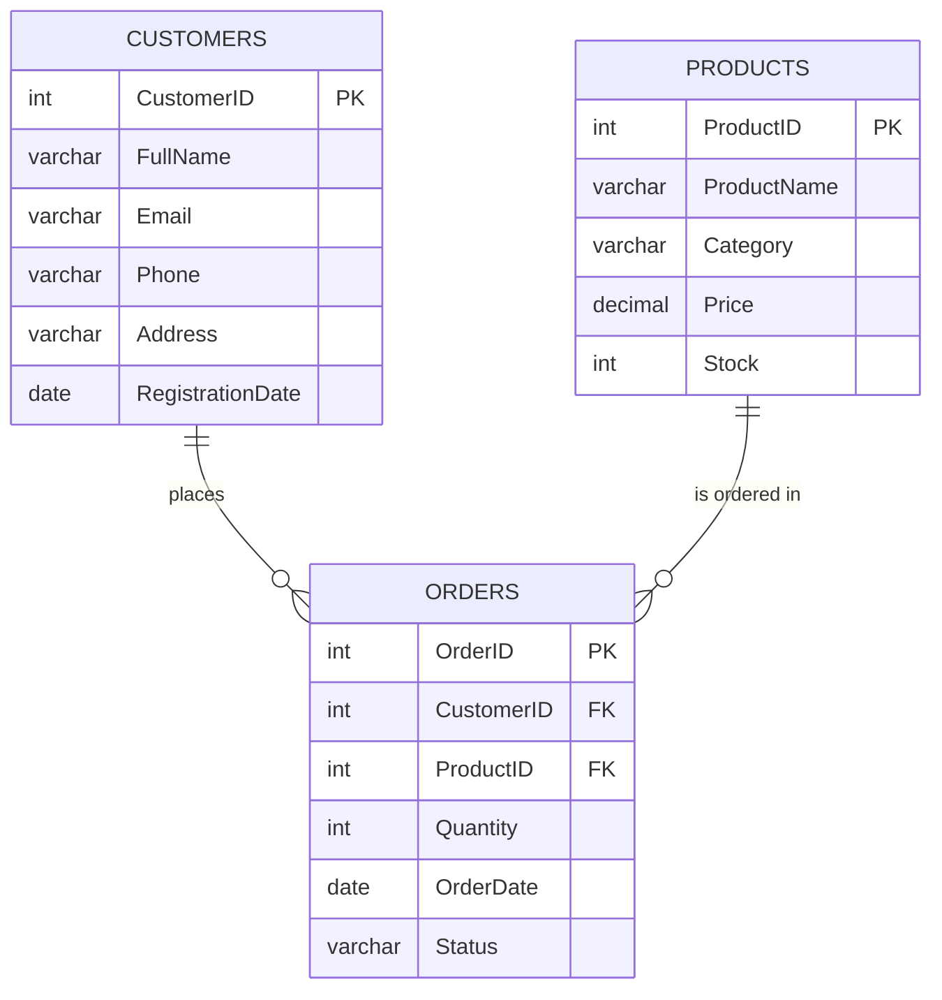

# Order Management System

A web app to manage customers, products and orders, with a dashboard and sales reports.
Built with ASP.NET Core MVC and SQL Server during the InfoSysTech training.

## Features

- Add, edit, delete and search **Customers**, **Products** and **Orders**
- Filter products by category and orders by status
- Stock updates automatically when an order is placed, cancelled or deleted
- Customer details page with order history and total spending
- **Dashboard** and **Reports** with real data: revenue, orders by status, monthly sales, top products, customers and categories
- Validation and success / error messages

## Tech Stack

- ASP.NET Core MVC (.NET 10)
- Entity Framework Core 10
- SQL Server
- Bootstrap 5 and Chart.js

## Database



## How to Run

1. Install the .NET 10 SDK and SQL Server with SSMS.
2. In SSMS, run the script `Database/01_create_database.sql`.
3. In `appsettings.json`, replace `localhost` in the connection string with your server name (get it with `SELECT @@SERVERNAME;`).
4. In the terminal, from the project folder, run:

```
dotnet run
```

5. Open the address shown in the terminal, for example `http://localhost:5184`.

## Credits

Based on the InfoSysTech training project by Eng. Sana Mobasher.
Frontend template: ArchitectUI (MIT).

## Author

Basmala Alaa